# Pocket Device Simulator

A Chrome extension that opens the current page inside realistic phone, foldable, tablet, watch,
laptop and screen frames, with the matching identity, so you can test responsive sites and
mobile behaviour without leaving the desktop browser. Pixel-art (handheld LCD) interface,
English or Thai.

คู่มือภาษาไทยฉบับเต็ม: [mobile-sim/README.md](mobile-sim/README.md)

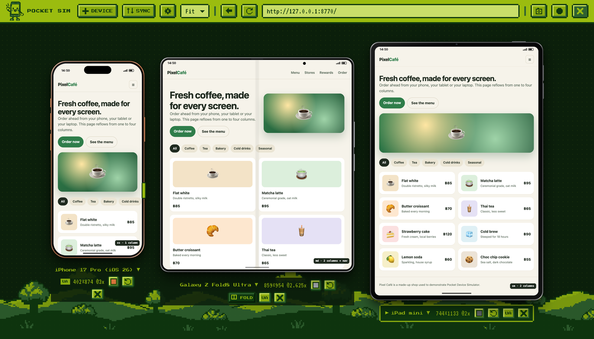

## Screenshots

All shots below were taken with the extension's own **"Device, no background"** screenshot mode
(transparent PNG) on a demo page, [docs/demo/](docs/demo/index.html), whose layout goes from one
column to four as the screen gets wider. The badge in the corner shows the active breakpoint.

### Phones

| iPhone 17 Pro | Galaxy S25 Ultra | Pixel 10 Pro |
| :---: | :---: | :---: |
| 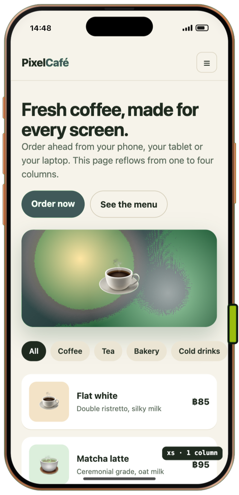 | 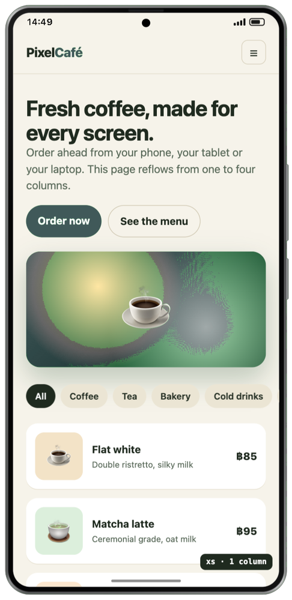 | 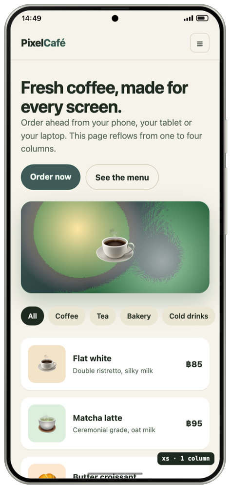 |

### Foldables

Fold and unfold with a 3D hinge animation; the page is not reloaded.

<p align="center">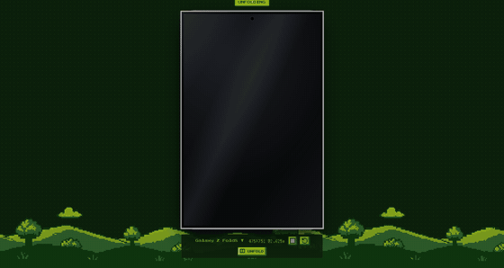</p>

| | Folded | Unfolded |
| :--- | :---: | :---: |
| **iPhone Duo** | 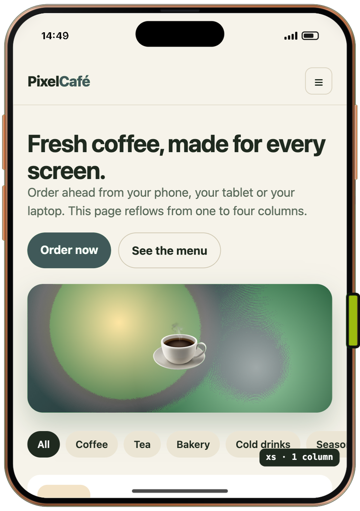 | 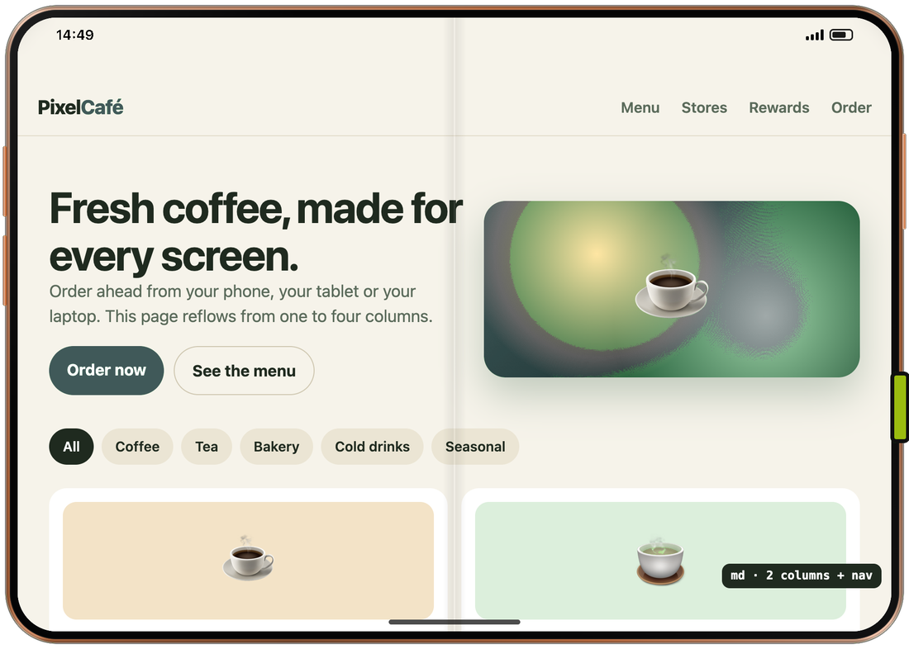 |
| **Galaxy Z Fold8** (wide) | 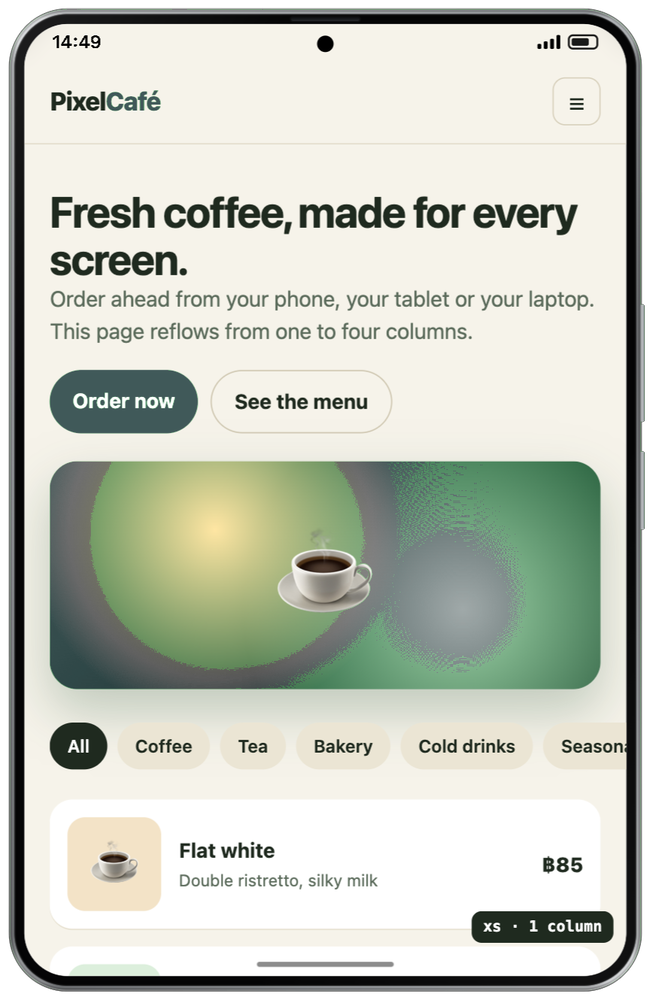 | 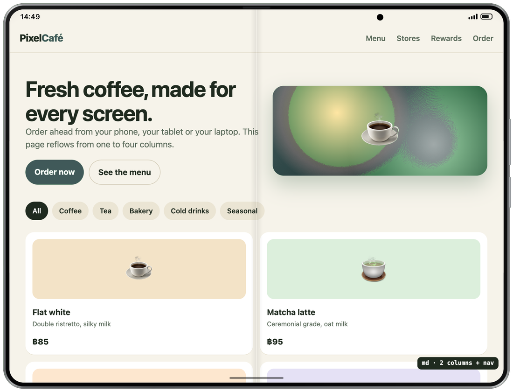 |
| **Galaxy Z Fold8 Ultra** (same body as Fold7) | 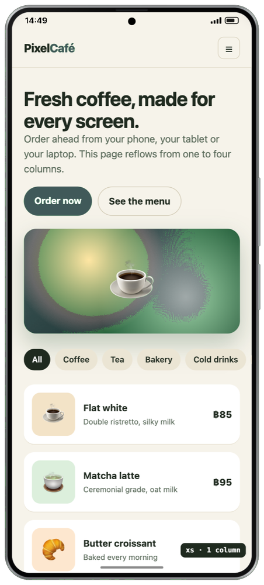 | 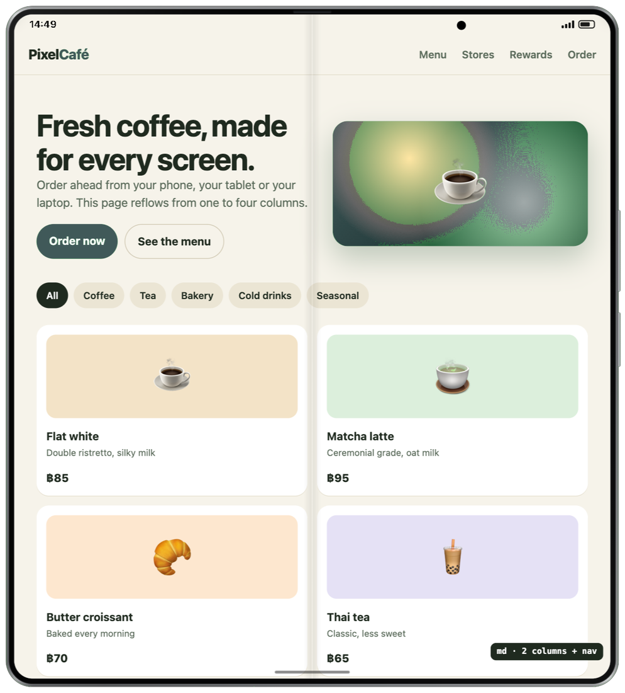 |

### Tablets

| iPad mini | iPad Pro 11" | iPad Pro 13" |
| :---: | :---: | :---: |
| 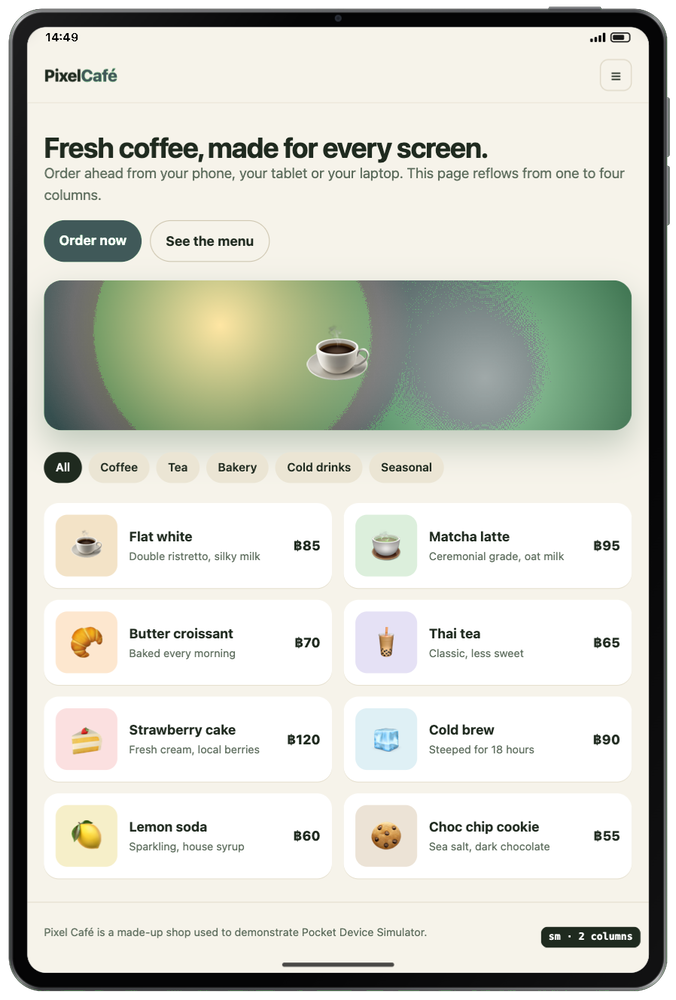 | 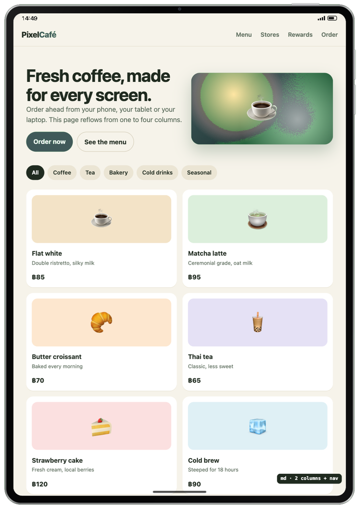 | 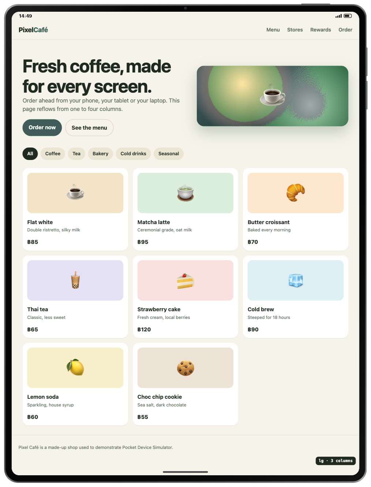 |

### Laptop

<p align="center">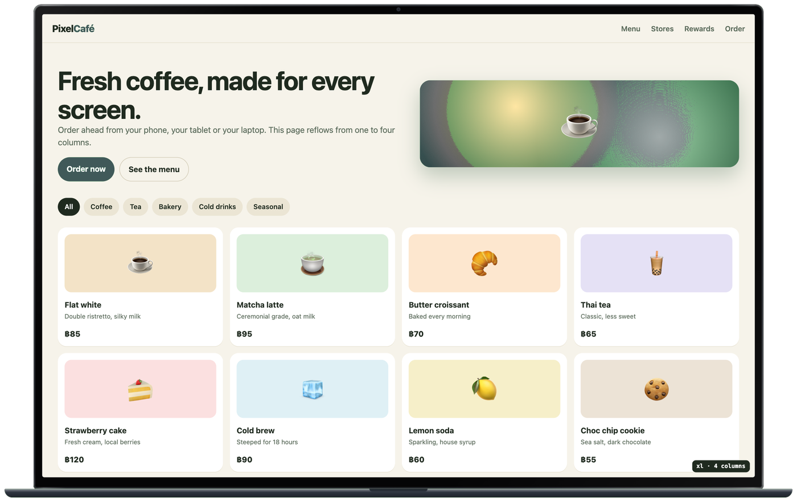</p>

Regenerate these images with `node docs/screenshots.mjs`.

## Install

1. Download or clone this repository (or build a zip with `./scripts/pack.sh` and unzip it).
2. Open `chrome://extensions`, turn on **Developer mode**, click **Load unpacked**, choose `mobile-sim/`.
3. Click the toolbar icon (or press `Alt+Shift+M`) on any http(s) page.

## Features

- **40 devices**: iPhone (incl. iOS 26 identity), Pixel, Galaxy, iPad, Galaxy Tab, Apple Watch,
  MacBook, Windows laptop, monitor, smart TV, kiosk, plus custom devices and a free-size
  **Responsive** mode with drag handles and a breakpoint ruler.
- **Foldables** from published specs (Galaxy Z Fold8, Fold8 Ultra, Fold7, Z Flip7, Pixel 10 Pro Fold,
  iPhone Duo) with a 3D fold/unfold animation; rotation animates too, without reloading the page.
- **Detailed frames**: metal band, front glass, side buttons per model, switchable colour finishes.
- **Identity**: tab-scoped User-Agent header (client hints removed) and matching JavaScript values
  (`navigator`, `screen`, `devicePixelRatio`, orientation, touch, `matchMedia` pointer/hover).
- **Touch**: the mouse acts like a finger (touch events, drag-to-scroll with momentum, tap → click).
- **Edge-to-edge screen** by default, like Chrome DevTools and app WebViews: the page fills the whole
  screen and the status bar floats over it (switch it off in Settings to put the status bar above the page).
- **Browser bars**, **safe-area insets** (`env(safe-area-inset-*)` with `viewport-fit=cover`) and a
  **virtual keyboard** (iOS / Android looks, numeric pad) that types into the page.
- **Several devices side by side** with synced scrolling and navigation.
- **Screenshots**: transparent device PNG, device on a colour, screen only (optionally rounded),
  full page (stitched), all devices in one image, or one PNG per device in a ZIP.
- **Screen recording** cropped to the device, with optional webcam bubble and microphone.
- **Page language** (navigator, `Accept-Language`, `Intl` default locale) and **GPS** location.
- **Separate sessions per device** (opt-in): own cookies, `document.cookie`, Web Storage,
  IndexedDB and Cache Storage, so different accounts can be signed in side by side.
- **Accurate mode** (opt-in): dark/light `prefers-color-scheme` and reduced motion for page CSS,
  network throttling (Fast 4G, Slow 4G, 3G, Offline) and CPU slowdown.
- Saved device sets, loading indicators, recovery after the extension is reloaded.

Separate sessions and accurate mode use the `chrome.debugger` API, so Chrome shows its
"started debugging this browser" bar while they are on.

## How it works

`background.js` installs tab-scoped declarativeNetRequest rules (User-Agent, client hints,
X-Frame-Options/CSP for sub-frames, CSP that stops the original page's scripts in the top frame)
and reloads the tab. `shell.js` replaces the top document with the simulator UI and loads the page
again in same-origin iframes, one per device, so cookies stay first-party. `spoof.js` runs in each
device frame's main world at `document_start`. `sessions.js` and `debug.js` implement the opt-in
debugger features. `capture.js` handles screenshots, ZIP export and recording.

## Development

```sh
node tests/run.mjs            # all end-to-end suites (needs Python 3 and Chrome for Testing / Chromium)
node tests/run.mjs sessions   # one suite
./scripts/pack.sh             # dist/pocket-device-simulator-<version>.zip
```

Branded Google Chrome ignores `--load-extension`, so the tests look for Chrome for Testing in the
Playwright cache (`npx playwright install chromium`) or use `CHROME_PATH`.

## Limitations

It is desktop Chrome with an emulated viewport and identity, not Safari/WebKit or a real device.
CSS `@media (hover/pointer)` and `srcset` density use the desktop values unless accurate mode
covers them; one User-Agent header applies per tab (the device marked **UA**).

## Credits

Pixel fonts: Press Start 2P and VT323 (SIL Open Font License, see `mobile-sim/fonts/`).
Pixel art generated for this project (see `art/SOURCES.md`).

## License

[MIT](LICENSE). The bundled fonts keep their own SIL Open Font License.
