# Pocket Device Simulator (คู่มือภาษาไทย)

ส่วนขยาย Chrome สำหรับเปิดหน้าเว็บในกรอบมือถือ จอพับ แท็บเล็ต นาฬิกา แล็ปท็อป หรือทีวี
พร้อมตัวตนของอุปกรณ์นั้น ทั้ง User-Agent, ขนาดจอ และ touch หน้าตา UI เป็นพิกเซลแบบเครื่องเกมพกพา เลือกได้ทั้งภาษาไทยและอังกฤษ

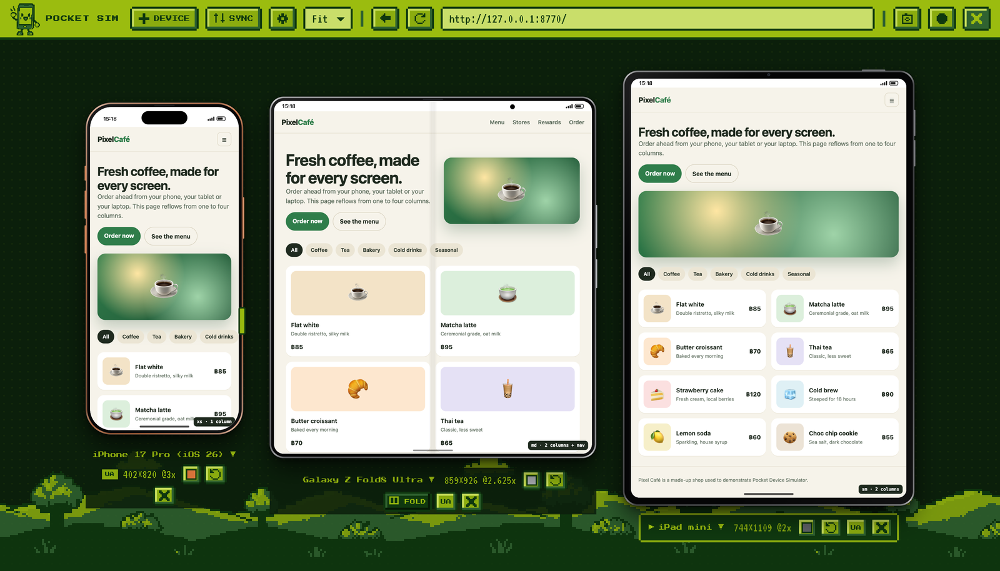

## ตัวอย่าง

ภาพทั้งหมดถ่ายด้วยโหมด "ตัวเครื่อง ไม่มีพื้นหลัง" ของ extension เอง บนหน้าเว็บตัวอย่าง [docs/demo](../docs/demo/index.html)
ซึ่งจัดเลย์เอาต์ตั้งแต่ 1 ถึง 4 คอลัมน์ตามความกว้างจอ ป้ายที่มุมขวาล่างบอก breakpoint ที่ใช้อยู่

| iPhone 17 Pro | Galaxy S25 Ultra | Pixel 10 Pro |
| :---: | :---: | :---: |
| 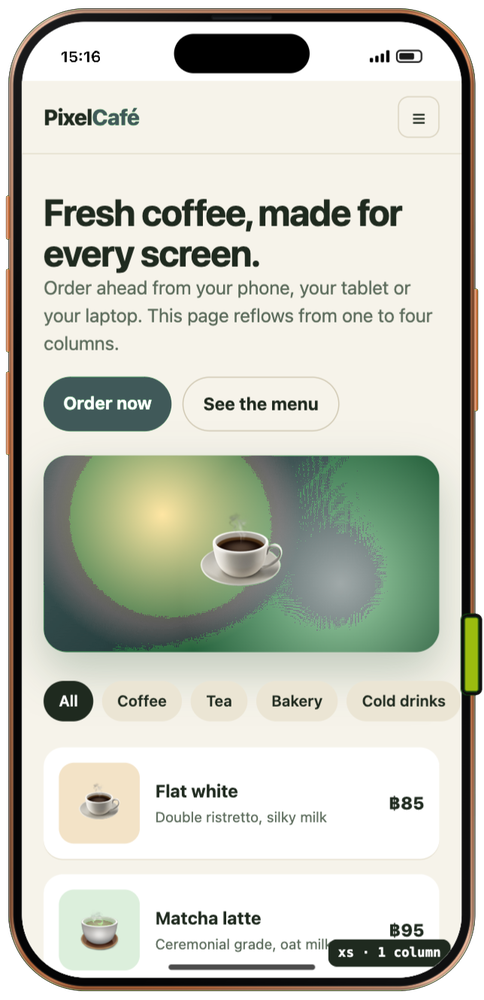 | 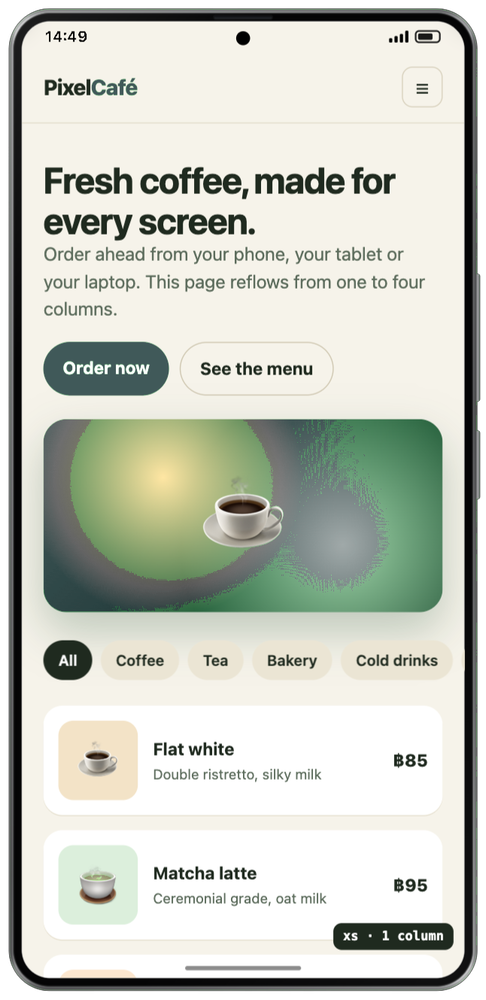 | 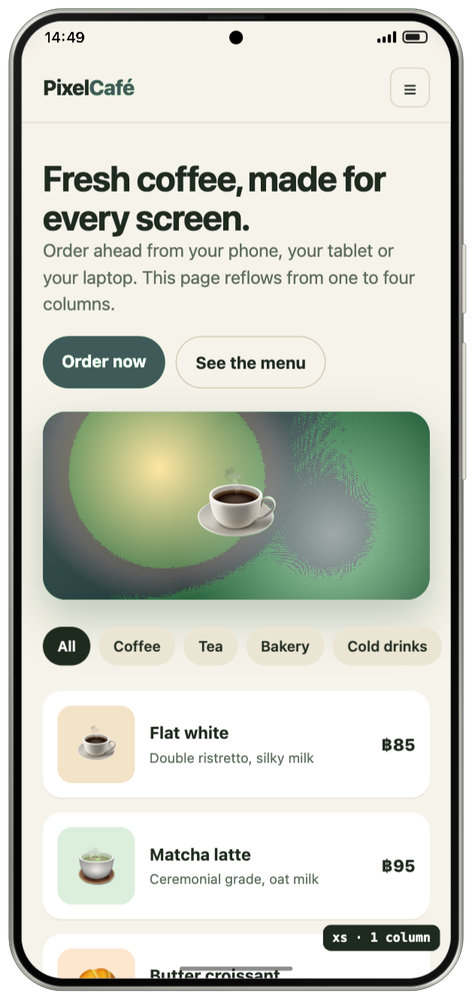 |

| จอพับ | พับ | กาง |
| :--- | :---: | :---: |
| **iPhone Duo** | 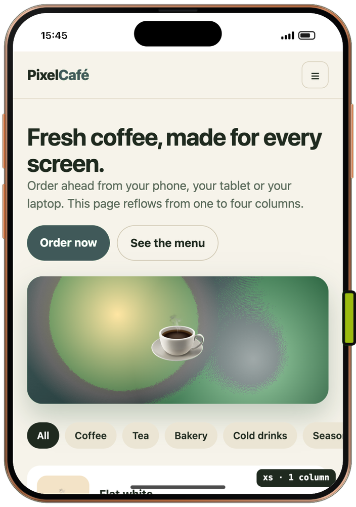 | 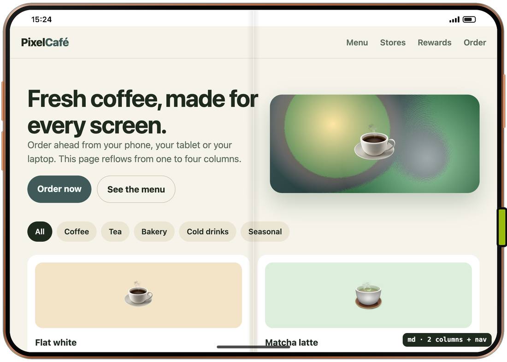 |
| **Galaxy Z Fold8** (รุ่นจอกว้าง) | 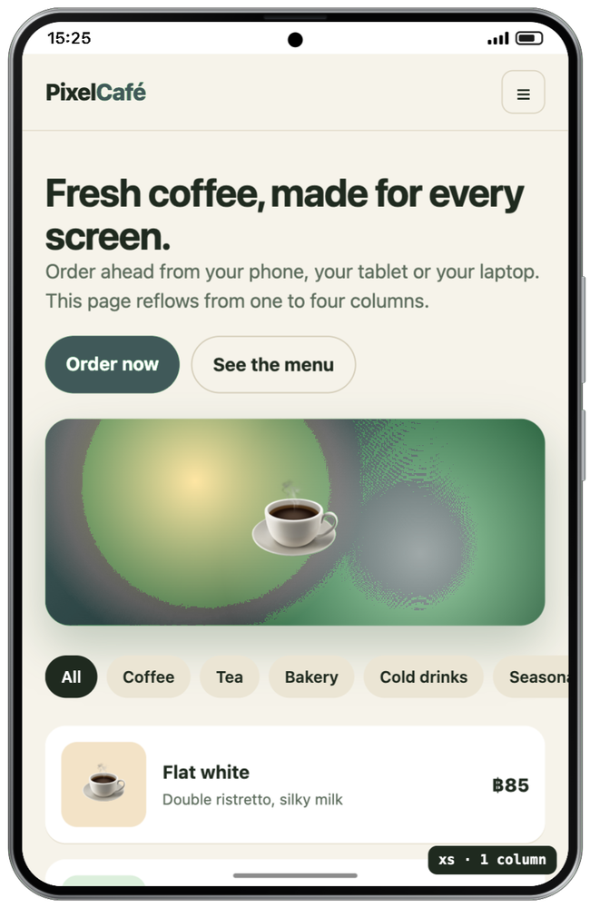 | 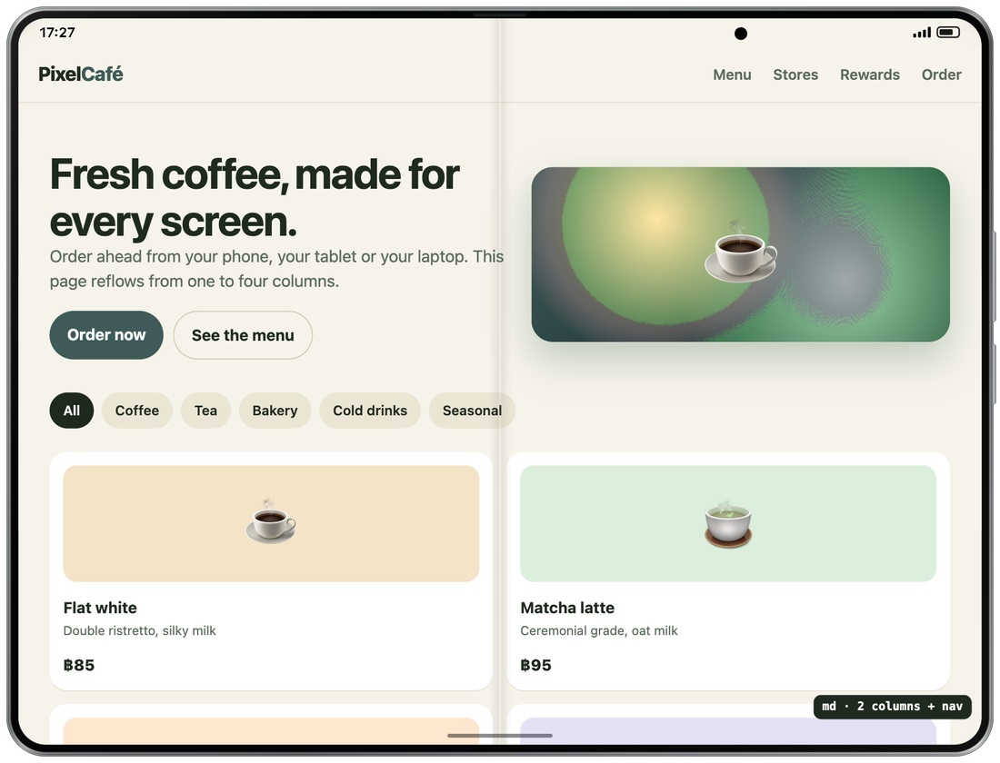 |
| **Galaxy Z Fold8 Ultra** (ตัวเครื่องเหมือน Fold7) | 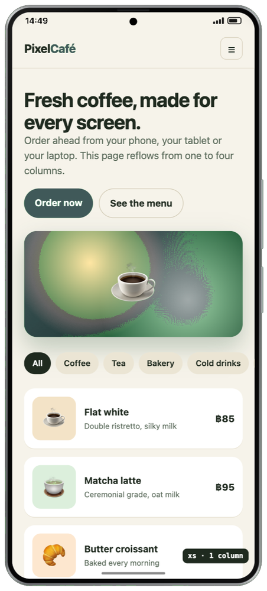 | 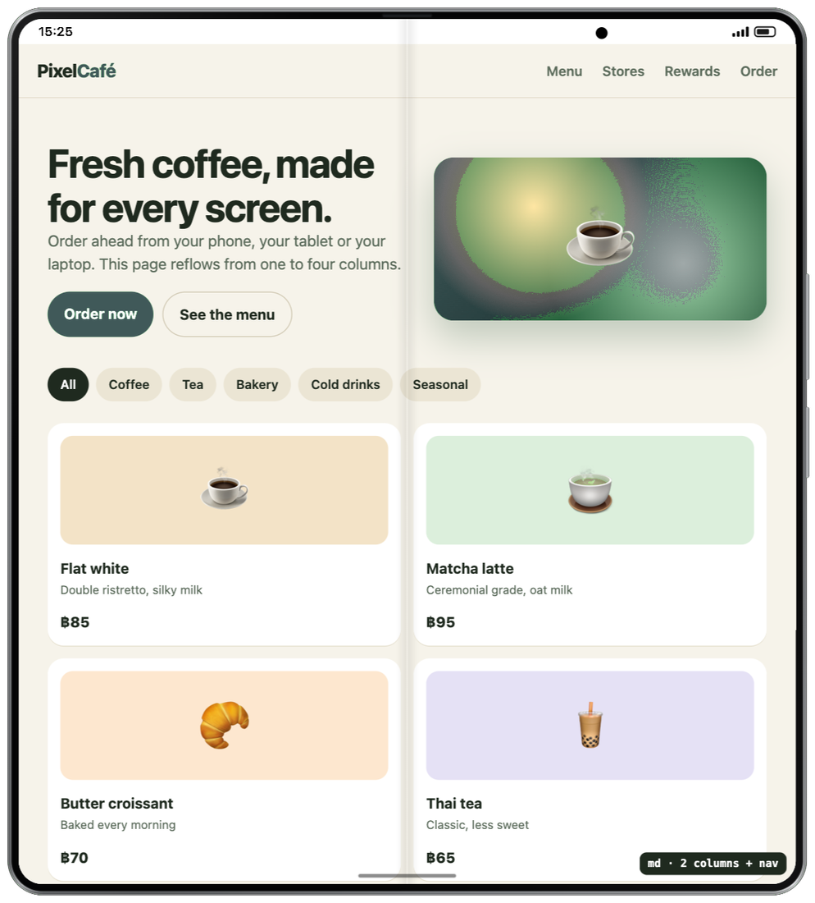 |

<p align="center">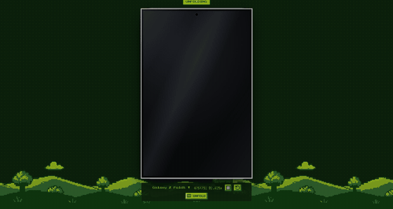</p>

| iPad mini | iPad Pro 11" | iPad Pro 13" |
| :---: | :---: | :---: |
| 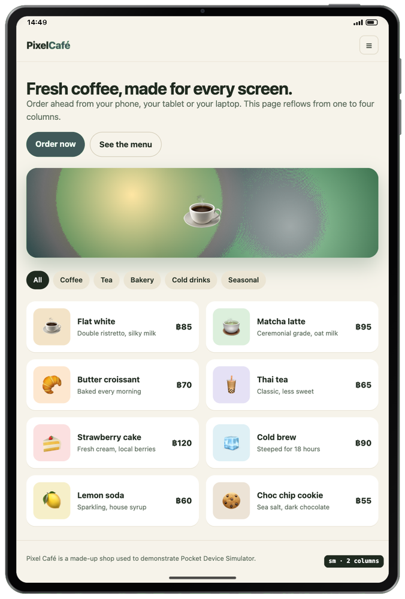 | 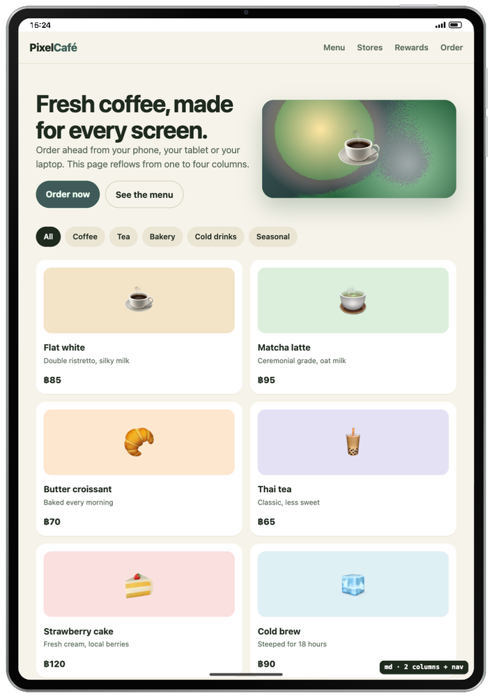 | 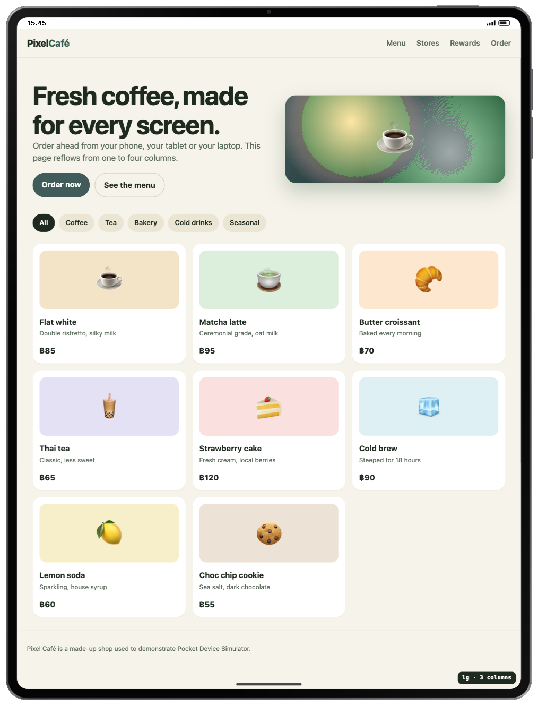 |

<p align="center">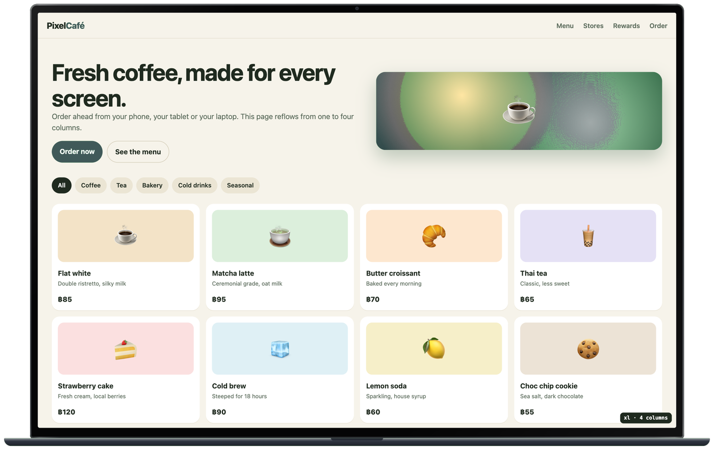</p>

สร้างภาพชุดนี้ใหม่ได้ด้วย `node docs/screenshots.mjs`

## ติดตั้ง
1. เปิด `chrome://extensions` แล้วเปิด **Developer mode**
2. กด **Load unpacked** แล้วเลือกโฟลเดอร์ `mobile-sim`
   ถ้าแก้ไฟล์หรือ `git pull` มา ให้กด ↻ ที่การ์ดของ extension แท็บที่เปิดจำลองอยู่จะกลับมาเองหลังรีโหลด
3. กดไอคอน หรือกด `Alt+Shift+M` บนหน้าเว็บไหนก็ได้

## แถบเครื่องมือ
- **＋ อุปกรณ์:** เพิ่มเครื่องข้าง ๆ กัน
- **ซิงก์:** ซิงก์การเลื่อนหน้าและการนำทาง ตามเฉพาะสิ่งที่คุณกด หน้าในแอปแบบ SPA (React/Expo) เปลี่ยนตามโดยไม่โหลดใหม่
- **⚙ ตั้งค่า**
- **ซูม**
- **ย้อนกลับ / รีโหลด / ช่อง URL**
- **📷 ภาพหน้าจอ**
- **⏺ อัดวิดีโอ**
- **✕ ออก**

ใต้แต่ละเครื่องมีปุ่มให้กดเลือกรุ่น เปลี่ยนสีตัวเครื่อง หมุนจอ พับ/กาง เลือกเครื่องที่ใช้ UA และเอาเครื่องออก

## ฟีเจอร์
- **อุปกรณ์ 40 รุ่น:** มี Apple, Android, จอพับ, แท็บเล็ต และนาฬิกา/แล็ปท็อป/จอ/ทีวี/คีออสก์ สร้างอุปกรณ์เองได้
- **โหมด Responsive:** ลากขอบเพื่อปรับขนาดอิสระ มีไม้บรรทัด breakpoint ช่องพิมพ์ขนาด ขนาดสำเร็จรูป และสลับมือถือ/เดสก์ท็อป
- **จอพับ ใช้สเปกจริง:** Galaxy Z Fold8 (รุ่นจอกว้าง), Fold8 Ultra, Fold7, Z Flip7, Pixel 10 Pro Fold และ iPhone Duo
  แอนิเมชันพับ/กางเป็น 3D และหน้าเว็บไม่โหลดใหม่
  pixel ratio ของรุ่น Samsung/Google เป็นค่าประมาณจาก ppi เพราะผู้ผลิตไม่ได้เปิดเผย
- **กรอบเครื่องละเอียด:** ขอบโลหะ กระจกหน้า ปุ่มข้างตามตำแหน่งจริง และเปลี่ยนสีตัวเครื่องได้
- **Touch:** เมาส์ทำงานแบบนิ้ว ลากแล้วหน้าเลื่อนพร้อมแรงเหวี่ยง ส่ง touch event จริง แตะแล้วได้ click
- **หน้าเว็บเต็มจอ (ค่าเริ่มต้น):** เหมือน Chrome DevTools และ WebView ในแอป หน้าเว็บวิ่งถึงขอบบน แถบสถานะลอยทับ ปิดได้ใน ⚙ ตั้งค่า
- **แถบเบราว์เซอร์:** Safari/Chrome พร้อม **safe area** และ **คีย์บอร์ดเสมือน** ที่พิมพ์ลงหน้าเว็บได้
- **ภาพหน้าจอ:**
  - ตัวเครื่องพื้นใส (PNG)
  - ตัวเครื่องบนพื้นสี
  - เฉพาะจอ (มุมโค้งพื้นใสได้)
  - ทั้งหน้า
  - ทุกเครื่องในภาพเดียว หรือแยกทีละเครื่องเป็น .zip
- **อัดวิดีโอ:** ครอปเฉพาะตัวเครื่อง ใส่เว็บแคมได้ เปิดไมค์ได้ เลือกคุณภาพได้ ไม่จำกัดเวลา
- **ตั้งค่า (⚙):**
  - ภาษาของหน้าเว็บ (navigator, header `Accept-Language`, `Intl`)
  - ตำแหน่ง GPS
  - ชุดอุปกรณ์ที่บันทึกไว้
  - ภาษาของหน้าจอ
- **โหมดแม่นยำ:**
  - โหมดมืด/สว่าง และลดการเคลื่อนไหว ที่ CSS ของหน้าเว็บเห็นจริง
  - จำกัดความเร็วเน็ต (Fast 4G / Slow 4G / 3G / Offline)
  - CPU ช้าลง 4–6 เท่า
- **ตัวบอกสถานะ:** แถบโหลดและการ์ด Loading ตอนหน้าเว็บโหลด และป้ายสถานะตอนพับ/หมุน

โหมดแม่นยำใช้สิทธิ์ `debugger` ของ Chrome ระหว่างเปิดใช้จะมีแถบ "started debugging this browser" ขึ้นมา
ถ้ากดปิดแถบนั้น โหมดนี้จะปิดตามอัตโนมัติ

## ข้อจำกัด
- **ไม่ใช่เครื่องจริง:** เป็น Chrome บนเดสก์ท็อปที่จำลองขนาดจอและตัวตน ไม่ใช่ Safari/WebKit
- **CSS ใช้ค่าจริงของเดสก์ท็อป:** `@media (hover/pointer)` ใน CSS กับรูป `srcset` ยังใช้ค่าจริงของเดสก์ท็อป
- **User-Agent ต่อแท็บ:** header User-Agent ใช้ค่าเดียวต่อแท็บ คือเครื่องที่มีป้าย UA แต่ฝั่ง JavaScript แต่ละเครื่องยังถูกต้อง
- **คุกกี้และการล็อกอินใช้ร่วมกัน:** ทุกเครื่องในแท็บใช้คุกกี้และ storage ชุดเดียวกัน ล็อกอินคนละบัญชีพร้อมกันไม่ได้ ถ้าต้องการให้ใช้หน้าต่าง Incognito หรือ Chrome profile แยก
- **ภาพเต็มหน้า:** ต้องเป็นหน้าเว็บที่อ่านได้ และซ่อนแถบ fixed/sticky ตั้งแต่ภาพที่ 2

## สำหรับนักพัฒนา
```sh
node tests/run.mjs        # ทดสอบอัตโนมัติทั้งหมด
./scripts/pack.sh         # สร้าง dist/pocket-device-simulator-<version>.zip
```

## ที่มาของรูปและฟอนต์
- **ฟอนต์:** Press Start 2P และ VT323 (SIL Open Font License) อยู่ใน `fonts/`
- **รูปพิกเซล:** เจนด้วย MaxPlus ดูรายละเอียดใน `art/SOURCES.md`
